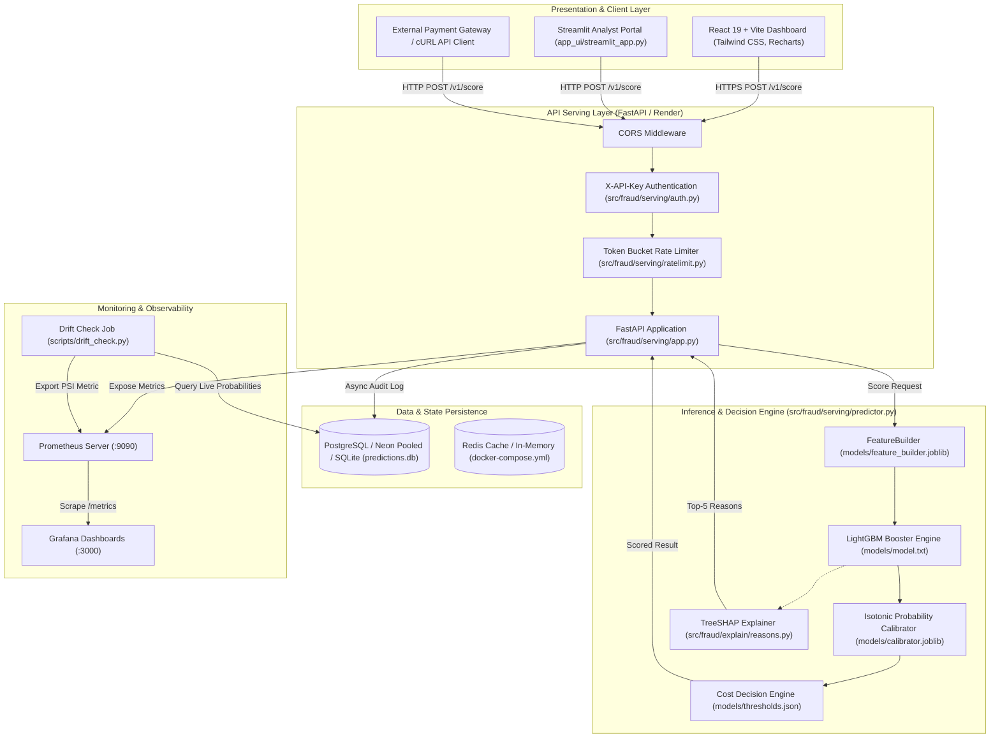

# 00 - Project Overview: Real-Time Fraud Scoring Service

## 1. What the Project Does

The **Real-Time Fraud Scoring Service** (`fraud-scoring-service`) is an end-to-end, production-grade Machine Learning and API system that assesses the risk of financial transaction fraud in real time (< 300 ms). Given a transaction payload containing card identifiers, monetary amounts, recipient information, email domains, and device metadata, the service:
1. Validates and ingests the raw transaction.
2. Applies real-time feature transformations (frequency encodings, domain extraction, interaction terms, missingness aggregations) strictly aligned with the offline training schema.
3. Scores the transaction using a trained **LightGBM Gradient Boosted Decision Tree** model.
4. Calibrates raw model probability outputs using an **Isotonic Regression Calibrator** so that a predicted score of `0.05` represents a true 5% empirical fraud frequency.
5. Evaluates a business cost-optimal decision engine to output one of three automated operational actions:
   - **`APPROVE`**: Transaction is legitimate; frictionless user experience.
   - **`MANUAL REVIEW`**: Ambiguous risk; automatically queued for human fraud analysts.
   - **`BLOCK`**: High certainty of fraud; immediate rejection.
6. Generates **Top-5 per-prediction SHAP (SHapley Additive exPlanations) reason codes** with contribution magnitudes and directionality (`increases_risk` vs `lowers_risk`) using native TreeSHAP margins for regulatory transparency and fraud investigator explainability.
7. Logs every scoring decision to an audit database (**PostgreSQL / SQLite** with WAL mode) for compliance, dispute management, and drift tracking.
8. Exports Prometheus operational and statistical metrics (`fraud_requests_total`, `fraud_api_request_latency_seconds`, `fraud_prediction_score`, `fraud_decisions_total`).
9. Provides two interactive frontends:
   - A modern, reactive **React 19 + Vite + Tailwind CSS** production dashboard.
   - A rapid-prototyping **Streamlit** analyst portal.

---

## 2. Real-World Problem It Solves

### The Core Problem in Financial Fraud Detection
In card-not-present (CNP) and electronic banking transactions, payment processors and merchants face severe financial and operational tradeoffs:
- **Massive Class Imbalance**: Genuine transactions represent > 96.5% of total volume; fraud accounts for ~3.5% (or < 0.1% in many retail banking scenarios). Traditional accuracy metrics are meaningless (a naive model predicting "all clean" achieves 96.5% accuracy but prevents $0 of fraud).
- **Asymmetric Financial Loss Matrix**:
  - A **False Negative (FN)** (failing to catch a fraudulent transaction) costs the merchant the entire transaction amount plus chargeback penalties ($15–$50 per chargeback).
  - A **False Positive (FP)** (declining a legitimate customer) causes customer churn, brand damage, and a human review cost (approx. $10.00 manual review agent overhead).
- **Temporal Non-Stationarity & Adversarial Concept Drift**: Fraudsters continually adapt attack vectors, card testing routines, and IP proxies. A model evaluated with random cross-validation yields artificially high scores due to future data leakage.
- **Latency Constraints**: Payment gateways (Stripe, Adyen, Visa Direct) impose strict timeout budgets (typically 100–500 ms). Complex ensembles or heavy deep learning models that take seconds cannot be used in the synchronous payment authorization path.
- **Explainability Regulations**: Regulations like GDPR, the Fair Credit Reporting Act (FCRA), and banking directives mandate that automated rejections and holds must provide interpretable adverse action reason codes.

### How This Project Solves It
- Trained on **590,540 real-world transactions** from the Kaggle IEEE-CIS benchmark.
- Evaluated on a **strict time-series held-out test set** (Day 152 to Day 182) completely separated chronologically from training data (Day 1 to Day 120) and validation data (Day 120 to Day 152), guaranteeing true out-of-time evaluation without temporal leakage.
- Yields **0.9103 ROC-AUC** and **0.5289 PR-AUC** (calibrated Average Precision) on out-of-time test data.
- Employs cost-minimization optimization to compute empirical thresholds ($t_{\text{review}} = 0.0595$, $t_{\text{block}} = 0.7500$).
- In sustained load tests (4 workers, load generator on same machine), executes full inference + feature transformation in **5.23 ms p50** without SHAP (184.4 req/s) and **36.43 ms p50** with TreeSHAP explanations (26.0 req/s) at concurrency 1, sustaining **22.23 ms p50** without SHAP and **87.64 ms p50** with SHAP at concurrency 10.

---

## 3. Complete Architecture

---

## 4. End-to-End Data and Request Flow

### Request Flow (Online Real-Time Serving)
1. **Client Call**:
   A payment client sends an HTTP `POST /v1/score?explain=true` with a JSON payload containing transaction details and the header `X-API-Key: demo-api-key-12345`.
2. **Auth & Security Check**:
   - `src/fraud/serving/auth.py` validates the API key against configured secrets (`ALLOWED_API_KEYS`).
   - `src/fraud/serving/ratelimit.py` verifies client request frequency using sliding window timestamps against rate limits (default 5,000 requests per minute).
3. **Pydantic Validation**:
   - `src/fraud/serving/schemas.py` validates the request payload using `Transaction` schema (e.g., verifying `TransactionAmt > 0`).
4. **Feature Transformation**:
   - `FraudPredictor` passes the transaction dictionary to `FeatureBuilder.transform()`.
   - Feature engineering derives:
     - Temporal features: `day_index`, `hour_of_day`, `day_of_week`.
     - Financial indicators: `log_TransactionAmt`, `amt_cents`, `amt_is_round`.
     - Email features: `P_emaildomain_provider`, `P_emaildomain_suffix`, `email_domain_match`.
     - Frequency mappings: `card1_fq`, `addr1_fq`, `card1_addr1_fq`, etc., looking up pre-computed frequencies learned strictly during training.
     - Identity missingness: `id_missing_count`, `has_identity`.
   - Aligns feature columns precisely with `models/feature_spec.json` (457 features).
5. **Model Inference**:
   - `booster.predict(features_df)` generates a raw logit / margin and uncalibrated tree probability.
6. **Probability Calibration**:
   - `ProbabilityCalibrator.calibrate()` applies isotonic piecewise linear mapping fitted on validation data to compute a true calibrated fraud probability.
7. **Business Policy Decision**:
   - `make_decision()` compares calibrated probability $p$ against thresholds:
     - If $p \ge 0.7500$ $\rightarrow$ `"block"` (Risk Band: `High`).
     - Else if $p \ge 0.0595$ $\rightarrow$ `"review"` (Risk Band: `Medium`).
     - Else $\rightarrow$ `"approve"` (Risk Band: `Low`).
8. **SHAP Reason Code Computation**:
   - If `explain=true`, `explain_prediction()` calls `booster.predict(features_df, pred_contrib=True)` to get exact feature margins in $O(\text{depth} \times \text{trees})$. It maps the top 5 highest absolute contributions to readable labels and direction flags.
9. **Telemetry & Audit Logging**:
   - Prometheus metrics are updated in-memory (`REQUEST_COUNT`, `REQUEST_LATENCY`, `PREDICTION_SCORE`, `DECISION_COUNT`).
   - `log_prediction_to_db()` safely writes the transaction ID, timestamp, probability, decision, risk band, and latency to PostgreSQL or SQLite.
10. **Response Delivery**:
    - The API returns a JSON `ScoreResponse` containing calibrated probability, operational decision, risk band, top-5 reasons, latency, and model version.

---

## 5. Major Components and Their Roles

| Component | Primary Files | Role & Responsibility |
|---|---|---|
| **Configuration** | `configs/config.yaml`, `src/fraud/config.py` | Centralized hyperparameter and path definitions. |
| **Data Ingestion & Splitting** | `src/fraud/data/download.py`, `ingest.py`, `split.py` | Download Kaggle CSVs, merge transactions & identity, downcast memory, and execute time-based temporal splitting. |
| **Feature Engineering** | `src/fraud/features/builder.py`, `scripts/build_features.py` | State-preserving `FeatureBuilder` ensuring zero feature drift between training and serving. |
| **Model Training & Baselines** | `src/fraud/models/train_lgbm.py`, `baseline.py` | Baseline model benchmarks (Dummy, Logistic Regression) and Optuna-tuned LightGBM training with early stopping. |
| **Calibration & Thresholds** | `src/fraud/models/calibrate.py`, `threshold.py` | Isotonic probability calibration and asymmetric business cost optimization. |
| **Model Explainability** | `src/fraud/explain/reasons.py` | ~22 ms per-prediction TreeSHAP contribution extraction. |
| **Evaluation & Drift** | `src/fraud/evaluation/metrics.py`, `drift.py`, `scripts/evaluate_pipeline.py` | Metric calculations (PR-AUC, ROC-AUC, ECE, Brier) and Population Stability Index (PSI) drift tracking. |
| **API Serving** | `src/fraud/serving/app.py`, `predictor.py`, `schemas.py` | High-throughput asynchronous REST API exposing `/v1/score`, `/v1/score/batch`, `/v1/model/info`, `/metrics`. |
| **Security & Persistence** | `src/fraud/serving/auth.py`, `ratelimit.py`, `db.py` | API key authentication, rate-limiting, and relational audit logging. |
| **Frontend Interfaces** | `frontend/` (React + Vite), `app_ui/streamlit_app.py` | Production analyst web dashboard and Streamlit interface. |
| **Deployment & Ops** | `Dockerfile`, `docker-compose.yml`, `render.yaml`, `vercel.json` | Containerization, local multi-service orchestration, and cloud deployment manifests. |
