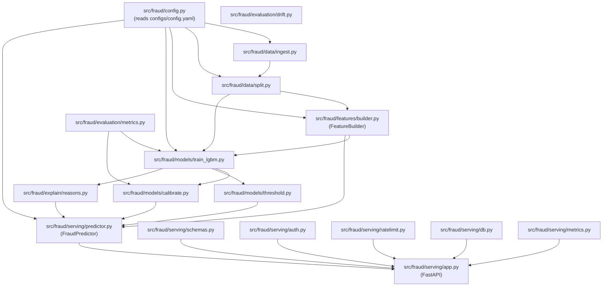

# 02 - Folder Structure & Codebase Architecture

This document maps every folder and file in the project, explains their internal responsibilities, details how modules connect with one another, and provides guidance on which files to read first.

---

## 1. Complete Directory Tree Overview

```text
fraud-scoring-service/
├── .github/
│   └── workflows/
│       └── ci.yml                     # Continuous integration workflow (Ruff lint + Pytest)
├── app_ui/                            # Streamlit analytical user interface
│   ├── index.html                     # Fallback landing / redirect page for Vercel
│   └── streamlit_app.py               # Interactive Python UI with presets and Matplotlib plots
├── configs/                           # Central configuration
│   └── config.yaml                    # Global paths, split ratios, seeds, and cost parameters
├── data/                              # Data directories (raw, interim, processed)
│   ├── raw/                           # Raw IEEE-CIS CSV files (transaction, identity)
│   ├── interim/                       # Cleaned, merged, and optimized Parquet file
│   └── processed/                     # Placeholder for offline feature matrices
├── frontend/                          # Production React 19 + Vite web frontend
│   ├── public/                        # Static SVGs and icons
│   ├── src/
│   │   ├── assets/                    # Static assets
│   │   ├── components/                # Modular React UI components
│   │   │   ├── Navbar.jsx             # Top brand header and tab switcher
│   │   │   ├── ScoreForm.jsx          # Input form with preset transaction buttons
│   │   │   ├── ScoreResults.jsx       # Decision badges, progress gauge, Recharts SHAP bar chart
│   │   │   ├── BatchScorer.jsx        # Multi-record JSON editor and bulk scoring table
│   │   │   ├── AuditLog.jsx           # Query historical predictions from PostgreSQL/SQLite
│   │   │   └── ModelInfo.jsx          # Metadata card displaying version, thresholds, metrics
│   │   ├── services/
│   │   │   └── api.js                 # Axios API client pointing to FastAPI backend
│   │   ├── App.jsx                    # Root React component managing active tabs
│   │   ├── main.jsx                   # React DOM entry point
│   │   └── index.css                  # Global Tailwind CSS styling rules
│   ├── package.json                   # NPM frontend package dependencies
│   └── vite.config.js                 # Vite bundler configuration
├── models/                            # Trained artifacts & metadata
│   ├── model.txt                      # Serialized native LightGBM booster model
│   ├── feature_builder.joblib         # Fitted FeatureBuilder instance (frequencies, categories)
│   ├── feature_spec.json              # Canonical list of 457 features and expected data types
│   ├── calibrator.joblib              # Fitted Isotonic Regression probability calibrator
│   └── thresholds.json                # Optimized business thresholds (t_review, t_block)
├── monitoring/                        # Operational observability configurations
│   ├── prometheus.yml                 # Prometheus scrape configuration for /metrics endpoint
│   └── grafana/
│       └── dashboard.json             # Pre-configured Grafana operations dashboard
├── notebooks/                         # Exploratory research notebooks
│   └── 01_eda.ipynb                   # Jupyter notebook examining distributions & fraud trends
├── reports/                           # Output metrics, figures, and markdown reports
│   ├── figures/                       # Analytical plots (distributions, calibration, SHAP, drift)
│   ├── data_profile.json              # Ingestion profiling metrics (row count, memory, groups)
│   ├── split_info.json                # Date and fraud distribution across Train/Val/Test splits
│   ├── eda_summary.md                 # Markdown summary of EDA findings and modeling choices
│   ├── metrics_baselines.json         # Baseline performance metrics (Dummy, LogReg, LightGBM)
│   ├── metrics_feature_ablation.json  # Validation metrics comparing raw vs engineered features
│   ├── metrics_test_stage6.json       # Held-out test set metrics from initial LightGBM training
│   ├── evaluation_report.md           # Comprehensive model evaluation and operational report
│   ├── model_card.md                  # Standardized production model card
│   └── load_test.json                 # Latency benchmarks, RPS, and concurrency profiles
├── scratch/                           # Scratch scripts and temporary tests
│   └── test_neon_conn.py              # Script validating cloud Neon PostgreSQL connection
├── scripts/                           # Standalone executable CLI execution scripts
│   ├── download_data.py               # Downloads Kaggle dataset via kagglehub
│   ├── download_data.sh               # Shell script wrapper for dataset download
│   ├── run_eda.py                     # Executes EDA and generates figure plots
│   ├── generate_notebook.py           # Auto-generates Jupyter notebooks from Python code
│   ├── build_features.py              # Fits FeatureBuilder and saves model artifacts
│   ├── train.py                       # CLI script running LightGBM training & tuning
│   ├── evaluate.py                    # CLI script executing pipeline evaluation
│   ├── evaluate_pipeline.py           # Core evaluation script (calibration, SHAP, drift, PSI)
│   ├── drift_check.py                 # Prometheus daemon tracking PSI drift from database
│   ├── locustfile.py                  # Locust load test definition
│   ├── run_load_test.py               # Standalone load test benchmark script
│   └── make_report.py                 # Script compiling final summary reports
├── src/                               # Primary Python package source code
│   └── fraud/
│       ├── __init__.py                # Package initialization
│       ├── config.py                  # Config loader utility function
│       ├── data/                      # Ingestion, downcasting, and temporal splitting
│       │   ├── __init__.py
│       │   ├── download.py            # Local file locator and Kaggle dataset fetcher
│       │   ├── ingest.py              # Merges transaction + identity, downcasts, saves Parquet
│       │   └── split.py               # Leakage-safe time-based splitting and expanding CV
│       ├── features/                  # Feature engineering module
│       │   ├── __init__.py
│       │   └── builder.py             # FeatureBuilder class (fit on train, transform on inference)
│       ├── models/                    # Model training, baselines, and calibration
│       │   ├── __init__.py
│       │   ├── baseline.py            # Dummy, Logistic Regression, and default LightGBM
│       │   ├── train_lgbm.py          # Optuna hyperparameter tuning and LightGBM training
│       │   ├── calibrate.py           # ProbabilityCalibrator using Isotonic Regression
│       │   └── threshold.py           # Asymmetric cost-optimal threshold optimizer
│       ├── explain/                   # Model interpretability
│       │   ├── __init__.py
│       │   └── reasons.py             # TreeSHAP per-prediction contribution explanations
│       ├── evaluation/                # Performance metrics and drift analysis
│       │   ├── __init__.py
│       │   ├── metrics.py             # PR-AUC, ROC-AUC, Recall@P, ECE, Brier, Expected Cost
│       │   └── drift.py               # Population Stability Index (PSI) calculation
│       └── serving/                   # Real-time API serving infrastructure
│           ├── __init__.py
│           ├── app.py                 # FastAPI application, lifespan, endpoints, CORS
│           ├── predictor.py           # FraudPredictor singleton orchestrating inference
│           ├── schemas.py             # Pydantic v2 data models for requests and responses
│           ├── auth.py                # Header-based API key authentication dependency
│           ├── ratelimit.py           # Token bucket rate limiting with fallback
│           ├── db.py                  # SQLAlchemy engine, PredictionLog ORM, WAL SQLite / Postgres
│           └── metrics.py             # Prometheus metrics declarations
├── tests/                             # Comprehensive automated test suite
│   ├── __init__.py
│   ├── conftest.py                    # Pytest fixtures and mock objects
│   ├── test_config.py                 # Tests YAML configuration loading
│   ├── test_ingest.py                 # Tests data merging and memory downcasting
│   ├── test_split.py                  # Tests temporal split ratios and sorting
│   ├── test_no_leakage.py             # Strict verification that timestamps and IDs do not leak
│   ├── test_features.py               # Tests FeatureBuilder transform, categories, missingness
│   ├── test_baseline.py               # Tests baseline model outputs and probability validity
│   ├── test_calibration_thresholds.py # Tests Isotonic calibration and cost minimization
│   ├── test_explain_drift.py          # Tests SHAP contribution sum identity and PSI logic
│   ├── test_predictor.py              # Tests FraudPredictor end-to-end scoring logic
│   ├── test_api.py                    # Tests all FastAPI endpoints, auth, batch, audit, parity
│   └── test_metrics.py                # Tests mathematical correctness of PR-AUC, ECE, Brier
├── Dockerfile                         # Production multi-stage Docker build
├── docker-compose.yml                 # Local multi-container stack (API, PG, Redis, Prom, Grafana)
├── Makefile                           # Developer automation targets (setup, train, test, serve)
├── pyproject.toml                     # Python build system and tool configuration
├── requirements.txt                   # Production Python dependencies
├── requirements-dev.txt               # Development dependencies (pytest, ruff, locust)
├── render.yaml                        # Render cloud deployment manifest
├── vercel.json                        # Vercel frontend deployment configuration
├── predictions.db                     # Local SQLite audit log database (created at runtime)
└── README.md                          # Repository documentation and benchmark results
```

---

## 2. Module Interactions & Component Graph

The diagram below shows how the source code modules depend on each other:



---

## 3. Detailed File Responsibilities

### Core Source Directory (`src/fraud/`)

#### `config.py`
- Exposes `load_config(config_path)`.
- Resolves absolute paths relative to the project root and parses `configs/config.yaml`.
- Returns a typed dictionary with project settings, split boundaries, and financial cost assumptions.

#### `data/download.py`
- Checks whether raw CSVs (`train_transaction.csv`, `train_identity.csv`, etc.) exist in `data/raw/` or the root workspace.
- Relocates misplaced files and automatically downloads missing competition archives using `kagglehub`.

#### `data/ingest.py`
- Contains `downcast_df(df)`: iteratively inspects integer and floating columns and casts them to the smallest lossless NumPy representation (`uint8`, `uint16`, `uint32`, `float32`), while casting string objects to Pandas `category`.
- Executes a left join on `TransactionID` to combine transactions with identity attributes.
- Saves the resulting 590,540 rows $\times$ 434 columns to `data/interim/train_merged.parquet`.
- Generates `reports/data_profile.json` detailing row counts, memory footprint, and column block counts.

#### `data/split.py`
- Implements `time_split_data(df, train_ratio=0.70, val_ratio=0.15, test_ratio=0.15)`.
- Sorts strictly by `TransactionDT` (offset in seconds from Day 1 to Day 182).
- Splits into:
  - **Train**: Day 1 to Day 120 (413,378 rows, 3.52% fraud).
  - **Validation**: Day 120 to Day 152 (88,581 rows, 3.43% fraud).
  - **Test**: Day 152 to Day 182 (88,581 rows, 3.48% fraud).
- Implements `ExpandingWindowTimeSeriesSplit` for temporal cross-validation.
- Saves split statistics to `reports/split_info.json`.

#### `features/builder.py`
- Defines the `FeatureBuilder` class, the critical link between training and serving.
- `fit(train_df)`:
  - Learns frequency distribution counts for `card1`, `card2`, `card3`, `card5`, `addr1`, `addr2`, `P_emaildomain`, `DeviceInfo`, `id_30`, `id_31`, `id_33`, and the interaction `card1_addr1` strictly from training data.
  - Learns valid categorical level sets for all categorical variables strictly from training data.
- `transform(df)`:
  - Computes time indicators (`day_index`, `hour_of_day`, `day_of_week`).
  - Computes amount indicators (`log_TransactionAmt`, `amt_cents`, `amt_is_round`).
  - Splits email domains (`P_emaildomain_provider`, `P_emaildomain_suffix`, `email_domain_match`).
  - Maps frequency encodings, filling unseen serving categories with `0.0`.
  - Calculates identity missingness counters (`id_missing_count`, `has_identity`).
  - Aligns output columns with `self.final_feature_names` (457 features) and enforces data types.
- `save()` / `load()`: Serializes state to `models/feature_builder.joblib` and `models/feature_spec.json`.

#### `models/baseline.py`
- Implements benchmark models to validate that complex models provide real value:
  - `DummyClassifier(strategy="prior")`: Baseline PR-AUC = 0.0343.
  - `LogisticRegression(class_weight="balanced")` with median imputation and standard scaling: Baseline PR-AUC = 0.3806.
  - Default `LightGBM` on raw unengineered features: Baseline PR-AUC = 0.5303.
- Logs baseline runs to MLflow and writes `reports/metrics_baselines.json`.

#### `models/train_lgbm.py`
- Runs Bayesian hyperparameter optimization with Optuna over 5 trials (`run_optuna_tuning()`), tuning `learning_rate`, `num_leaves`, `min_child_samples`, `feature_fraction`, `bagging_fraction`, and L1/L2 regularization.
- Trains final LightGBM booster with early stopping (30 rounds on validation PR-AUC).
- Evaluates the held-out test set once.
- Saves native tree text model to `models/model.txt` and records run metrics to MLflow and `reports/metrics_test_stage6.json`.

#### `models/calibrate.py`
- Implements `ProbabilityCalibrator`.
- Fits an `IsotonicRegression(y_min=0.0, y_max=1.0, out_of_bounds="clip")` on validation prediction probabilities.
- Transforms raw model margins into well-calibrated probabilities.
- Evaluates Brier score and Expected Calibration Error (ECE) before and after calibration.
- Saves calibrator state to `models/calibrator.joblib`.

#### `models/threshold.py`
- Implements `optimize_thresholds(y_val, val_probs, val_amounts, fp_review_cost=10.0, target_block_precision=0.90)`.
- Calculates two operational policy boundaries:
  - `t_review`: Grid search evaluating total business financial loss:
    $$\text{Loss} = \sum (\text{FN} \times \text{TransactionAmt}) + \sum (\text{FP} \times \$10.00)$$
    Yields $t_{\text{review}} = 0.0595$.
  - `t_block`: Lowest probability threshold where precision $\ge 90\%$. Yields $t_{\text{block}} = 0.7500$.
- Contains `make_decision(prob, t_review, t_block)` mapping a probability to `"approve"`, `"review"`, or `"block"`.
- Saves configuration to `models/thresholds.json`.

#### `explain/reasons.py`
- Implements `explain_prediction(booster, feature_row, top_k=5)`.
- Invokes native C++ TreeSHAP via `booster.predict(feature_row, pred_contrib=True)`.
- Obtains exact feature-level log-odds contributions in ~22 ms compute time.
- Verifies that $\sum \text{contributions} + \text{bias} = \text{margin score}$.
- Ranks features by absolute contribution, assigns human-readable labels from `FEATURE_LABEL_MAP`, and flags whether each feature increases or lowers fraud risk.

#### `evaluation/metrics.py`
- Comprehensive evaluation metric library:
  - `compute_pr_auc()`: Average Precision under the precision-recall curve.
  - `compute_roc_auc()`: Area under ROC curve.
  - `recall_at_precision()`: Maximum achievable recall at a guaranteed precision threshold (e.g. 50% or 80%).
  - `recall_at_top_pct()`: Capture rate when flagging the top 1% or 5% highest-risk transactions.
  - `compute_brier_score()`: Mean squared error of probabilities against true binary outcomes.
  - `expected_calibration_error()` (ECE): Binned absolute difference between confidence and empirical accuracy.
  - `expected_cost()`: Direct financial dollar loss calculation.

#### `evaluation/drift.py`
- Implements `compute_psi(expected, actual, bins=10)`.
- Computes Population Stability Index to measure distribution shift between reference and production distributions:
  $$\text{PSI} = \sum (A_i - E_i) \times \ln\left(\frac{A_i}{E_i}\right)$$
- Interprets PSI values: $< 0.10$ is stable; $0.10$ to $0.20$ indicates moderate drift; $> 0.20$ requires model retraining.
- Implements `analyze_drift()` for top features between training and test sets.

#### `serving/app.py`
- FastAPI application bootstrap.
- Sets up lifespan context to load `FraudPredictor` into memory once during startup.
- Configures CORS middleware for frontend communication.
- Implements routes:
  - `GET /health`: Liveness probe.
  - `GET /ready`: Readiness probe verifying predictor health.
  - `GET /metrics`: Prometheus scrape endpoint.
  - `GET /v1/model/info`: Model metadata, version, and threshold boundaries.
  - `POST /v1/score`: Single transaction scoring with optional SHAP explanations.
  - `POST /v1/score/batch`: Bulk scoring up to 1,000 transactions.
  - `GET /v1/predictions/{transaction_id}`: Retrieves stored prediction records from the database.

#### `serving/predictor.py`
- Singleton service `FraudPredictor`.
- Loads `FeatureBuilder`, LightGBM `Booster`, `ProbabilityCalibrator`, and `thresholds.json`.
- Implements `score_dict(payload, explain=True)`: executes the full end-to-end pipeline on an incoming dictionary and measures latency in milliseconds.

#### `serving/schemas.py`
- Defines Pydantic v2 data transfer models:
  - `Transaction`: Validates incoming fields (`TransactionDT`, `TransactionAmt > 0`, card numbers, etc.).
  - `ScoreResponse`: Outgoing scoring response.
  - `BatchScoreRequest` & `BatchScoreResponse`: Bulk transaction payloads.
  - `ModelInfoResponse`: Metadata and threshold specifications.

#### `serving/auth.py`
- Validates the `X-API-Key` header against `ALLOWED_API_KEYS`. Returns HTTP 401 if missing and HTTP 403 if invalid.

#### `serving/ratelimit.py`
- In-memory sliding window rate limiter tracking request timestamps per client ID. Returns HTTP 429 when limits are exceeded.

#### `serving/db.py`
- Configures SQLAlchemy engine connecting to PostgreSQL or SQLite.
- Enables WAL mode on SQLite.
- Defines `PredictionLog` ORM model.
- `log_prediction_to_db()`: Thread-safe database writer using `_db_lock`. Gracefully handles database downtime without dropping client requests.

#### `serving/metrics.py`
- Declares Prometheus metrics (`REQUEST_COUNT`, `REQUEST_LATENCY`, `PREDICTION_SCORE`, `DECISION_COUNT`).

---

## 4. Which Files to Learn First (Recommended Reading Order)

If you are new to the codebase, read the files in this sequence:

1. **`configs/config.yaml`**: Understand the dataset definitions, paths, and business cost variables.
2. **`src/fraud/config.py`**: See how configuration is loaded.
3. **`src/fraud/data/split.py`**: Understand the temporal split strategy (why time order matters in fraud detection).
4. **`src/fraud/features/builder.py`**: Study the `FeatureBuilder` class to understand state fitting vs transformation.
5. **`src/fraud/models/train_lgbm.py`**: See how LightGBM is trained with Optuna tuning and early stopping.
6. **`src/fraud/models/calibrate.py` & `threshold.py`**: Learn how raw scores are transformed into calibrated probabilities and operational decisions.
7. **`src/fraud/explain/reasons.py`**: Understand how native TreeSHAP extracts human-readable reason codes.
8. **`src/fraud/serving/predictor.py`**: Observe how all model components combine into a single inference pipeline.
9. **`src/fraud/serving/app.py` & `schemas.py`**: See how the prediction engine is exposed as a production REST API.
10. **`tests/test_no_leakage.py` & `tests/test_api.py`**: Examine how temporal safety and API contracts are validated.
