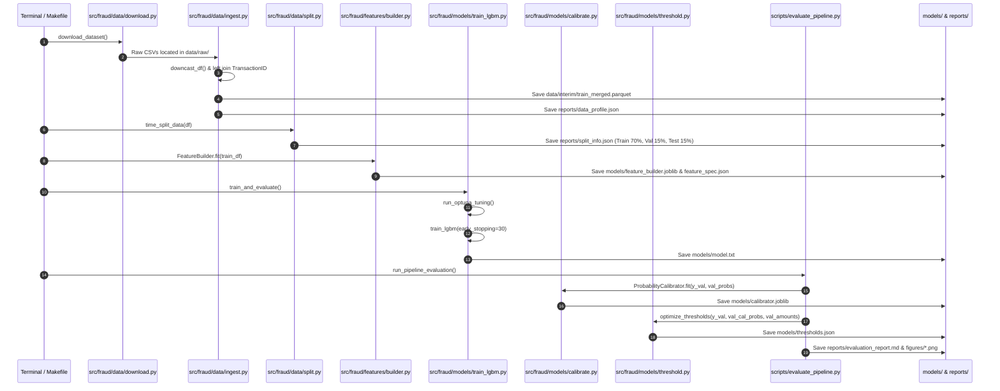
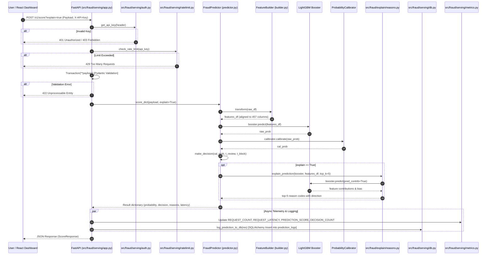

# 04 - Code Flow & Execution Lifecycle

This document traces the complete execution lifecycle of the **Fraud Scoring Service** across two primary operational modes:
1. **The Offline Training & Evaluation Lifecycle**: Raw CSV ingestion $\rightarrow$ feature fitting $\rightarrow$ LightGBM training $\rightarrow$ probability calibration $\rightarrow$ threshold optimization $\rightarrow$ report generation.
2. **The Online Real-Time Serving Lifecycle**: Client input $\rightarrow$ frontend components $\rightarrow$ API routing $\rightarrow$ validation $\rightarrow$ feature transformation $\rightarrow$ model scoring $\rightarrow$ SHAP explanation $\rightarrow$ audit logging $\rightarrow$ response delivery.

---

## 1. Offline Training & Evaluation Lifecycle

The offline pipeline trains the model, fits transformation state, calibrates probabilities, and optimizes business thresholds.



### Step-by-Step Code Walkthrough (Offline Flow)

#### 1. Ingestion (`src/fraud/data/ingest.py`)
- Entry point: `ingest_data(config_path)`
- Loads `data/raw/train_transaction.csv` (394 columns) and `data/raw/train_identity.csv` (41 columns).
- Calls `df_merged = pd.merge(df_txn, df_id, on="TransactionID", how="left")`.
- Calls `downcast_df(df_merged)`: iterates over all columns, converts string objects to `category`, float64 to `float32`, and integers to the smallest unsigned/signed integer types (`uint8`, `uint16`, `uint32`).
- Saves compressed dataset to `data/interim/train_merged.parquet`.
- Computes summary statistics and saves to `reports/data_profile.json`.

#### 2. Temporal Splitting (`src/fraud/data/split.py`)
- Entry point: `time_split_data(df, train_ratio=0.70, val_ratio=0.15, test_ratio=0.15)`
- Verifies `df["TransactionDT"]` is sorted chronologically.
- Computes partition boundaries:
  - `Train`: Indices $0$ to $413,377$ (Days 1–120).
  - `Validation`: Indices $413,378$ to $501,958$ (Days 120–152).
  - `Test`: Indices $501,959$ to $590,539$ (Days 152–182).
- Saves split statistics to `reports/split_info.json`.

#### 3. Feature Fitting (`src/fraud/features/builder.py`)
- Entry point: `FeatureBuilder.fit(train_df)`
- Constructs `train_df["card1_addr1"] = train_df["card1"].astype(str) + "_" + train_df["addr1"].astype(str)`.
- Learns frequency maps for 12 columns (`card1`, `card2`, `card3`, `card5`, `addr1`, `addr2`, `P_emaildomain`, `DeviceInfo`, `id_30`, `id_31`, `id_33`, `card1_addr1`) strictly from `train_df`.
- Records valid categorical levels for categorical features.
- Saves instance to `models/feature_builder.joblib` and feature names/types to `models/feature_spec.json`.

#### 4. Model Training & Tuning (`src/fraud/models/train_lgbm.py`)
- Entry point: `train_and_evaluate()`
- Transforms Train, Validation, and Test sets using `fb.transform()`.
- Runs `run_optuna_tuning(X_train, y_train, X_val, y_val, n_trials=5)`:
  - Uses Optuna to sample `learning_rate` (0.05–0.15), `num_leaves` (31–127), `min_child_samples` (20–200), `feature_fraction` (0.7–0.95), and L1/L2 penalties.
  - Returns `study.best_params`.
- Trains final booster via `train_lgbm()` with early stopping (30 rounds without validation PR-AUC improvement).
- Saves model text file to `models/model.txt`.
- Logs run parameters, metrics, and artifacts to MLflow (`mlflow.db`).

#### 5. Calibration & Cost Thresholds (`scripts/evaluate_pipeline.py`)
- Entry point: `run_pipeline_evaluation()`
- Loads `FeatureBuilder` and LightGBM `Booster`.
- Fits `ProbabilityCalibrator` via `calibrator.fit(y_val, val_raw_probs)`:
  - Fits Scikit-learn's `IsotonicRegression(y_min=0.0, y_max=1.0, out_of_bounds="clip")`.
  - Saves calibrator to `models/calibrator.joblib`.
- Calls `optimize_thresholds(y_val, val_cal_probs, val_amounts)`:
  - Evaluates cost grid to determine $t_{\text{review}} = 0.0595$.
  - Finds lowest threshold achieving precision $\ge 90\%$ to determine $t_{\text{block}} = 0.7500$.
  - Saves thresholds to `models/thresholds.json`.
- Computes test set calibration reliability, per-time-slice PR-AUC, and feature drift PSI, outputting plots to `reports/figures/` and the markdown report to `reports/evaluation_report.md`.

---

## 2. Online Real-Time Serving Lifecycle

The online pipeline handles incoming HTTP requests from the client down to model inference and audit persistence.



---

## 3. End-to-End Code Trace (Online Scoring Flow)

### 1. User Interaction (Frontend)
- **File**: `frontend/src/components/ScoreForm.jsx`
- The user selects a preset (e.g. "Low-Risk Card Purchase") or enters custom values.
- On submit, `handleScoreSubmit` triggers `scoreTransaction(payload, explain)` in `frontend/src/services/api.js`.
- Axios sends an HTTP `POST` to `${VITE_API_URL}/v1/score?explain=true` with the header `X-API-Key: demo-api-key-12345`.

### 2. Request Handling & Routing (Backend)
- **File**: `src/fraud/serving/app.py`
- Route: `@app.post("/v1/score", response_model=ScoreResponse)`
- The request passes through two FastAPI dependencies:
  1. `api_key: str = Depends(get_api_key)`
  2. `check_rate_limit(api_key)`

### 3. Authentication Check
- **File**: `src/fraud/serving/auth.py`
- Function: `get_api_key(api_key_header)`
- Inspects header `X-API-Key`.
- If missing $\rightarrow$ raises `HTTPException(401, "Missing API key header 'X-API-Key'")`.
- If not present in `ALLOWED_API_KEYS` $\rightarrow$ raises `HTTPException(403, "Invalid API key")`.

### 4. Rate Limiting Check
- **File**: `src/fraud/serving/ratelimit.py`
- Function: `check_rate_limit(client_id)`
- Checks recent request timestamps for `client_id` within the 60-second window.
- If request count $\ge 5000$ $\rightarrow$ raises `HTTPException(429, "Rate limit exceeded")`.
- Otherwise, records the current timestamp and proceeds.

### 5. Schema Validation
- **File**: `src/fraud/serving/schemas.py`
- Class: `Transaction(BaseModel)`
- Validates field types: ensures `TransactionAmt > 0`, casts `TransactionDT` to integer.
- `ConfigDict(extra="allow")` allows extra fields to pass through safely without errors.

### 6. Predictor Execution
- **File**: `src/fraud/serving/predictor.py`
- Method: `FraudPredictor.score_dict(payload, explain=True)`
- Starts the latency clock: `start_time = time.perf_counter()`.
- Wraps payload in a single-row DataFrame: `raw_df = pd.DataFrame([payload])`.

### 7. Real-Time Feature Transformation
- **File**: `src/fraud/features/builder.py`
- Method: `FeatureBuilder.transform(raw_df)`
- Executes `_transform_raw(raw_df)`:
  - Computes time indicators: `day_index`, `hour_of_day`, `day_of_week`.
  - Computes amount features: `log_TransactionAmt = np.log1p(amt)`, `amt_cents`, `amt_is_round`.
  - Splits email domains into provider and suffix; evaluates `email_domain_match`.
  - Combines `card1` and `addr1` into `card1_addr1`.
  - Looks up frequency encodings from `self.freq_maps` (unseen categories default to `0.0`).
  - Computes identity missingness indicators: `id_missing_count`, `has_identity`.
- Aligns features against `self.final_feature_names` (457 columns), filling missing fields with `np.nan`.
- Applies stored categorical types via `_apply_categoricals()`.

### 8. Booster Inference
- **File**: `src/fraud/serving/predictor.py`
- Method: `self.booster.predict(features_df)`
- LightGBM evaluates the feature vector across all trees in the ensemble.
- Returns uncalibrated raw probability `raw_prob`.

### 9. Probability Calibration
- **File**: `src/fraud/serving/predictor.py` & `src/fraud/models/calibrate.py`
- Method: `self.calibrator.calibrate(np.array([raw_prob]))`
- Maps `raw_prob` through the fitted Isotonic Regression piecewise function.
- Returns calibrated probability `cal_prob` (clipped to $[0.0, 1.0]$).

### 10. Business Policy Decision
- **File**: `src/fraud/models/threshold.py`
- Function: `make_decision(cal_prob, self.t_review, self.t_block)`
- Evaluates operational boundaries:
  - If `cal_prob >= 0.7500` $\rightarrow$ `"block"` (Risk Band: `"High"`).
  - Else if `cal_prob >= 0.0595` $\rightarrow$ `"review"` (Risk Band: `"Medium"`).
  - Else $\rightarrow$ `"approve"` (Risk Band: `"Low"`).

### 11. SHAP Reason Code Computation
- **File**: `src/fraud/explain/reasons.py`
- Function: `explain_prediction(booster, features_df, top_k=5)`
- Calls `booster.predict(features_df, pred_contrib=True)[0]`:
  - Returns array of length $458$ (457 feature contributions + 1 bias term).
- Computes `abs_indices = np.argsort(-np.abs(feat_contribs))[:top_k]`.
- For the top 5 features:
  - Resolves human-readable label from `FEATURE_LABEL_MAP` (e.g., `"card1_fq"` $\rightarrow$ `"Card1 Frequency"`).
  - Determines risk direction: `"increases_risk"` if contribution $> 0$, else `"lowers_risk"`.

### 12. Database Logging & Telemetry
- **Files**: `src/fraud/serving/db.py` & `src/fraud/serving/metrics.py`
- In `src/fraud/serving/app.py`:
  - Increments Prometheus counters:
    - `REQUEST_COUNT.labels(endpoint="/v1/score", status="200").inc()`
    - `REQUEST_LATENCY.labels(endpoint="/v1/score").observe(elapsed)`
    - `PREDICTION_SCORE.observe(cal_prob)`
    - `DECISION_COUNT.labels(decision=decision).inc()`
  - Calls `log_prediction_to_db(res)`:
    - Acquires thread lock `_db_lock`.
    - Creates SQLAlchemy session `SessionLocal()`.
    - Inserts `PredictionLog` record (`transaction_id`, `timestamp`, `fraud_probability`, `decision`, `risk_band`, `model_version`, `latency_ms`).
    - Commits and closes session.

### 13. Response Delivery
- **File**: `src/fraud/serving/app.py`
- Returns a validated `ScoreResponse` JSON payload:
```json
{
  "transaction_id": "tx_demo_101",
  "fraud_probability": 0.0215,
  "decision": "approve",
  "risk_band": "Low",
  "reasons": [
    {
      "feature": "card1_fq",
      "label": "Card1 Frequency",
      "value": "1000",
      "contribution": -0.4123,
      "direction": "lowers_risk"
    }
  ],
  "model_version": "0.1.0",
  "thresholds": {
    "t_review": 0.0595,
    "t_block": 0.7500
  },
  "latency_ms": 284.15
}
```
- The React frontend receives the response and updates the dashboard, displaying the decision badge, probability progress bar, and Recharts horizontal SHAP contribution chart.
