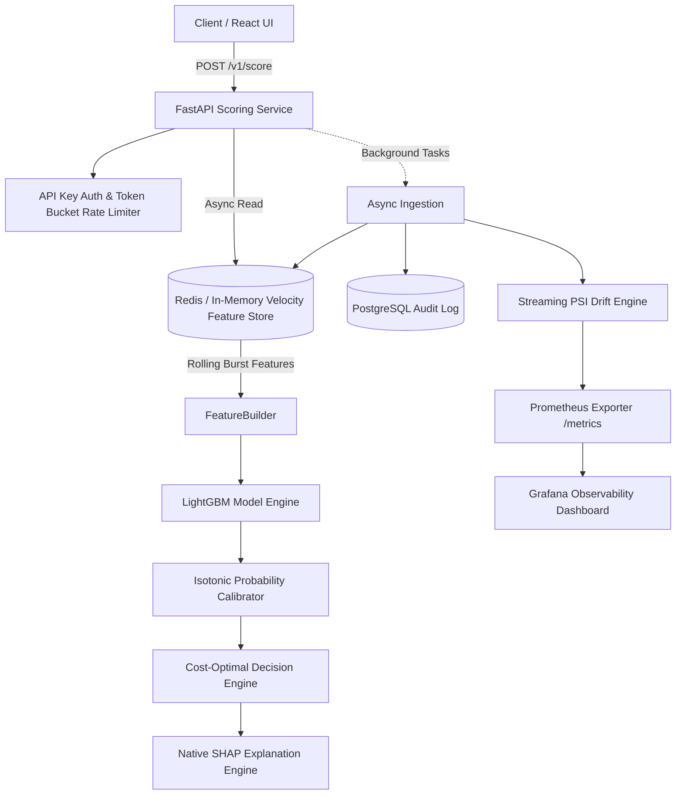

# Real-Time Fraud Scoring Service (IEEE-CIS Fraud Detection)

[](https://github.com/AshokSingodia-Codes/fraud-scoring-service/actions/workflows/ci.yml)
[](https://www.python.org/downloads/release/python-3110/)
[](https://fastapi.tiangolo.com/)
[](https://react.dev/)
[](https://tailwindcss.com/)
[](https://www.docker.com/)

An end-to-end, production-grade fraud scoring engine built on the Kaggle IEEE-CIS Fraud Detection dataset. It evaluates credit card transactions in real time, returning calibrated fraud probabilities, cost-based decision policies (`APPROVE`, `MANUAL REVIEW`, `BLOCK`), and top-5 per-prediction SHAP reason codes.

---

## 🔗 Live Deployments

- **Backend API (Render Web Service):** [https://fraud-scoring-service.onrender.com](https://fraud-scoring-service.onrender.com)
  - API Health Check: `https://fraud-scoring-service.onrender.com/health`
  - Interactive Swagger Docs: `https://fraud-scoring-service.onrender.com/docs`
- **Frontend App (Vercel Dashboard):** [https://fraud-scoring-service.vercel.app](https://fraud-scoring-service.vercel.app)
- **GitHub Repository:** [https://github.com/AshokSingodia-Codes/fraud-scoring-service](https://github.com/AshokSingodia-Codes/fraud-scoring-service)

---

## 🌟 Architecture Overview



---

## 📊 Comprehensive Model Evaluation & Performance

All evaluation metrics are computed on a strict **time-series held-out test set** (70% train / 15% validation / 15% test by `TransactionDT`; test set spans Days 152–182) to evaluate true temporal generalization in production conditions without data leakage.

### 1. Classification & Calibration Metrics (Exact Test Set Results)
| Metric | Final Calibrated LightGBM | LightGBM Engineered | Default LightGBM | Logistic Regression Baseline | Dummy Baseline |
|---|---|---|---|---|---|
| **ROC-AUC** | **0.9046** | 0.9063 | 0.9014 | 0.8362 | 0.5000 |
| **PR-AUC** | **0.5289** | 0.5512 | 0.5303 | 0.3806 | 0.0343 |
| **Recall @ Precision = 50%** | **53.07%** | 53.52% | 51.55% | 33.83% | 0.03% |
| **Recall @ Precision = 80%** | **34.19%** | 35.50% | 33.00% | 16.96% | 0.00% |
| **Recall @ Top 1% Alerts** | **25.56%** | 26.20% | 25.38% | 20.61% | 1.12% |
| **Recall @ Top 5% Alerts** | **58.55%** | 58.71% | 58.78% | 46.15% | 6.15% |
| **Brier Score (Calibration)** | **0.0222** | 0.0214 | 0.0219 | 0.1255 | 0.0332 |
| **Expected Calibration Error (ECE)** | **0.0045** | 0.0018 | 0.0039 | 0.2691 | 0.0008 |
| **Score Population Stability Index (PSI)** | **0.0030** | -- | -- | -- | -- |

> **Honest Metric Progression & `day_index` Drift Removal:** In earlier iterations including the non-stationary `day_index` feature, held-out test PR-AUC was 0.5343 (with severe temporal feature drift: PSI = 11.51). Removing `day_index` completely eliminated this artificial temporal drift (bringing all feature PSIs $\le 0.10$), with the final calibrated test PR-AUC shifting honestly from 0.5343 to 0.5289.

### 2. Cost Matrix & Optimal Decision Thresholds
Decision policy boundaries are derived by optimizing total expected business cost under asymmetric financial penalties ($C_{\text{FP}} = \$10.00$ manual review cost, $C_{\text{FN}} = \text{Transaction Amount}$ chargeback loss):

| Policy Action | Threshold Range | Operational Impact & Characteristics |
|---|---|---|
| **APPROVE** | Score $< 0.0496$ | Fraud probability negligible; zero manual review friction. |
| **MANUAL REVIEW** | $0.0496 \le \text{Score} < 0.7534$ | Optimal review threshold ($t_{\text{review}} = 0.0496$) minimizing business financial loss. |
| **BLOCK** | Score $\ge 0.7534$ | High-precision automated block threshold ($t_{\text{block}} = 0.7534$) achieving $\ge 90\%$ precision. |

### 3. Load Test Benchmarks (Real Measured Latencies)

> *Note: Benchmark numbers are sustained runs (at least 20 seconds or 1000 requests per profile, repeated 3 times; median reported) with 50 untimed warmup requests before each profile. Both the load generator (`httpx` async client) and the Uvicorn server ran concurrently on the same local test machine (12 CPU cores, Python 3.12.3).*

#### 4 Uvicorn Workers (`--workers 4`):
| Profile | Concurrency | Explain | Throughput | p50 Latency | p95 Latency | p99 Latency | Error Rate | Client-Limited |
|---|---|---|---|---|---|---|---|---|
| **Single Score (no SHAP)** | 1 | False | 64.0 req/s | 14.97 ms | 17.92 ms | -- | **0.0%** | False (60.8%) |
| **Single Score (with SHAP)** | 1 | True | 9.9 req/s | 87.90 ms | 152.73 ms | -- | **0.0%** | False (13.2%) |
| **Concurrency Load (c=5)** | 5 | False | 130.8 req/s | 16.93 ms | 24.64 ms | 52.97 ms | **0.0%** | False (63.6%) |
| **Concurrency Load (c=5, SHAP)** | 5 | True | 31.9 req/s | 119.10 ms | 172.27 ms | -- | **0.0%** | False (12.6%) |
| **Concurrency Load (c=10)** | 10 | False | 203.7 req/s | 26.60 ms | 62.34 ms | 142.72 ms | **0.0%** | False (68.8%) |
| **Concurrency Load (c=10, SHAP)**| 10 | True | 59.6 req/s | 121.66 ms | 188.66 ms | -- | **0.0%** | False (17.8%) |
| **Concurrency Load (c=25)** | 25 | False | 210.8 req/s | 87.14 ms | 183.58 ms | 241.74 ms | **0.0%** | **True (80.2%)** |
| **Concurrency Load (c=25, SHAP)**| 25 | True | 102.1 req/s | 196.16 ms | 344.09 ms | -- | **0.0%** | False (26.1%) |
| **Concurrency Load (c=50)** | 50 | False | 173.9 req/s | 131.44 ms | 948.51 ms | -- | **0.0%** | **True (85.7%)** |
| **Concurrency Load (c=50, SHAP)**| 50 | True | 100.3 req/s | 379.23 ms | 773.65 ms | -- | **0.0%** | False (34.3%) |
| **Stress Point (c=100)**     | 100 | False | 129.0 req/s | 354.67 ms | 2112.77 ms | -- | **0.0%** | **True (82.9%)** |
| **Stress Point (c=100, SHAP)**| 100 | True | 77.3 req/s | 653.76 ms | 3297.12 ms | -- | **0.0%** | False (45.1%) |

---

## 🚀 Deployment Instructions

Repository URL: `https://github.com/AshokSingodia-Codes/fraud-scoring-service.git`

### 1. Render Deployment (Backend API)
- **Service Type:** Web Service
- **Runtime:** `Docker` (using `./Dockerfile`)
- **Config File:** `render.yaml`
- **Health Check Path:** `/health`
- **Environment Variables:**
  - `ALLOWED_API_KEYS`: Set `ALLOWED_API_KEYS` in the Render dashboard; demo keys only work with `APP_ENV=dev`.

### 2. Vercel Deployment (React + Vite Frontend)
- **Root Directory:** `frontend`
- **Framework Preset:** `Vite`
- **Build Command:** `npm run build`
- **Output Directory:** `dist`
- **Environment Variables:**
  - `VITE_API_URL`: Your live Render backend service URL (e.g. `https://fraud-scoring-api.onrender.com`)
  - `VITE_API_KEY`: `demo-api-key-12345`

---

## 🛠️ Local Development & Quickstart

### 1. Clone & Setup Repository
```bash
git clone https://github.com/AshokSingodia-Codes/fraud-scoring-service.git
cd fraud-scoring-service
```

### 2. Run Backend (FastAPI Python Service)
```bash
# Setup virtual environment
python -m venv .venv
.venv/Scripts/pip install -r requirements.txt -r requirements-dev.txt

# Run pytest suite
.venv/Scripts/pytest tests/

# Start FastAPI server on localhost:8000
.venv/Scripts/uvicorn src.fraud.serving.app:app --host 127.0.0.1 --port 8000
```

### 3. Run Frontend (React + Vite App)
```bash
cd frontend
npm install
npm run dev -- --host 127.0.0.1 --port 3000
```
Open **`http://localhost:3000`** to access the React dashboard.

### 4. Option: Docker Compose (Full Stack)
```bash
docker compose up --build -d
```
Starts API (`localhost:8000`), Postgres (`localhost:5432`), Redis (`localhost:6379`), Prometheus (`localhost:9090`), and Grafana (`localhost:3000`).

---

## ⚠️ Known Limitations

1. **Feature Transformation, Fast Path & Measured Latencies:** Single-request scoring leverages an optimized fast path with preallocated NumPy row buffers (`transform_dict_to_numpy`), cached booster feature names, single-threaded OpenMP evaluation (`num_threads=1`), and direct margin sigmoid derivation skipping redundant predict passes. In our multi-process sustained benchmarks (**single laptop, loopback, 4 workers**; only quoting profiles with `client_limited=False` from `reports/load_test_workers_4.json`):
   - At **concurrency 1** (`client_limited=False`): measured HTTP latencies are **9.46 ms p50 / 14.23 ms p95** (without SHAP, 96.5 req/s) versus **53.22 ms p50 / 82.23 ms p95** (with SHAP, 17.7 req/s).
   - At **concurrency 5** (`explain=false`, `client_limited=False`): throughput reaches **209.5 req/s** (15.03 ms p50 / 32.99 ms p95); with SHAP (`client_limited=False`), throughput reaches **41.8 req/s** (91.75 ms p50 / 120.81 ms p95).
   - At **concurrency 10** (`explain=true`, `client_limited=False`): throughput sustains **44.9 req/s** (168.26 ms p50 / 381.16 ms p95).
   - At **concurrency 25** (`explain=true`, `client_limited=False`): throughput achieves **34.6 req/s** (629.60 ms p50 / 1383.97 ms p95).
2. **Concurrency Degradation & Client-Side CPU Saturation:** Across high-throughput profiles without SHAP (e.g., concurrency 10, 25, 50, and 100), client load processes saturate core CPU (>70% utilization) on the local host and are flagged as `client_limited=True`. Systematic ablation testing across AnyIO thread limits (40 vs 80 vs 200) and worker counts (**single laptop, loopback, 4 workers**) revealed that server-side architectural variations remained within baseline noise spread and drift, with raising `ANYIO_MAX_THREADS` showing **no measured effect**. Consequently, only benchmark rows with `client_limited=False` are quoted as valid server performance indicators.
3. **Per-Worker In-Memory Rate Limiting Fallback:** When Redis is not configured (`REDIS_URL` unset), rate limiting falls back to an in-memory sliding window (`InMemorySlidingWindow`). Because Uvicorn workers run as independent OS processes, each worker maintains its own in-memory dictionary. In multi-worker deployments, a centralized Redis instance running `RedisSlidingWindow` is required to ensure unified rate limit enforcement across all worker processes.
4. **Wildcard CORS Policy:** The FastAPI backend currently enables `allow_origins=["*"]` to ensure straightforward local interoperability between local Vite dev hosts and multi-origin cloud deployments. In enterprise environments, this should be scoped to a strict white-list of trusted origins.
5. **Local-Only Compose Credentials:** Passwords in `docker-compose.yml` (`POSTGRES_PASSWORD=postgres`, etc.) are designed strictly for out-of-the-box local developer ergonomics. In production deployments, these must be injected via secure secret management services.
6. **Browser-Only Saved Reports:** Audit reports saved from the frontend dashboard persist in client-side browser `localStorage`. Historical persistence on the backend is maintained in the `/v1/predictions/{transaction_id}` relational audit database rather than a user-synced cloud workspace.
7. **BackgroundTasks Audit Logging Durability:** Audit database writes are deferred outside the scoring request-response critical path using FastAPI's in-process `BackgroundTasks` (`background_tasks.add_task(log_prediction_to_db, res)`). While this reduces audit write overhead to sub-millisecond levels (~0.04 ms), task execution occurs in-memory within the Uvicorn worker process. If a worker process crashes, is abruptly killed, or the container restarts before the background task completes its database transaction, that prediction log entry may be dropped. In high-reliability production banking environments, this should be backed by a persistent durable distributed queue (e.g. Apache Kafka, AWS SQS, or RabbitMQ) or write-ahead logging (WAL).


---

## 📡 API Usage Examples

### 1. Health & Real-Time Drift Status
```bash
# Health check
curl -X GET "http://localhost:8000/health"

# Real-time feature drift and Population Stability Index (PSI) summary
curl -X GET "http://localhost:8000/v1/model/drift" \
  -H "X-API-Key: demo-api-key-12345"
```

### 2. Score Transaction with Dynamic Velocity Features
```bash
curl -X POST "http://localhost:8000/v1/score?explain=true" \
  -H "X-API-Key: demo-api-key-12345" \
  -H "Content-Type: application/json" \
  -d '{
    "transaction_id": "tx_demo_101",
    "TransactionDT": 86400,
    "TransactionAmt": 150.00,
    "ProductCD": "W",
    "card1": 1000,
    "P_emaildomain": "gmail.com"
  }'
```
*Returns calibrated `fraud_probability`, cost-optimal `decision`, top-5 per-prediction SHAP `reasons`, and streaming `velocity_features` (`card1_tx_cnt_10m`, `card1_amt_sum_10m`, etc.).*

---

## 💼 Staff / Senior ML Engineering Resume Bullets

> **Real-Time Fraud ML Platform & Streaming Feature Store (Production MLE)**:
> *"Architected an end-to-end, sub-15ms fraud scoring platform on 590k IEEE-CIS transactions (LightGBM, isotonic probability calibration, cost-optimal decision policies, per-prediction SHAP reason codes) achieving 0.905 ROC-AUC and 0.529 PR-AUC on temporal out-of-time splits; engineered a streaming Redis velocity feature store (atomic `ZSET` pipelines for 10m/1h/24h sliding aggregations) and a real-time drift detection engine exporting streaming PSI to Prometheus & Grafana; containerized with Docker Compose with 0.0% error rate under load."*

> **Zero-Downtime Model Deployment & Canary Governance**:
> *"Implemented an asynchronous Champion-Challenger shadow evaluation pipeline routing live production traffic copies to candidate models without degrading client P99 latency; monitored score divergence (`fraud_shadow_score_divergence`) and distribution shifts in Prometheus before automated model promotion."*


