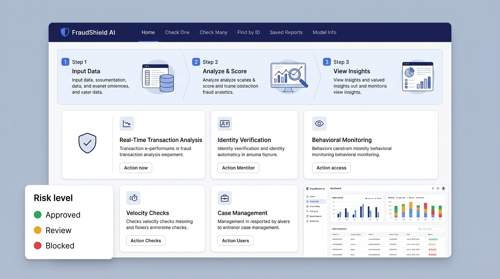
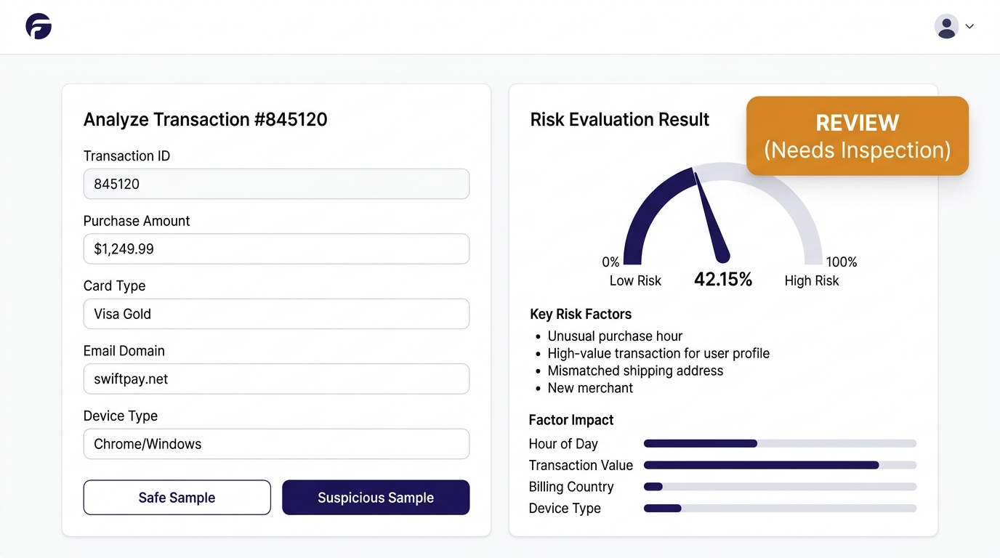
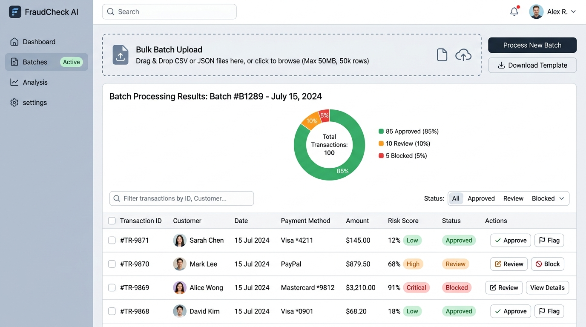
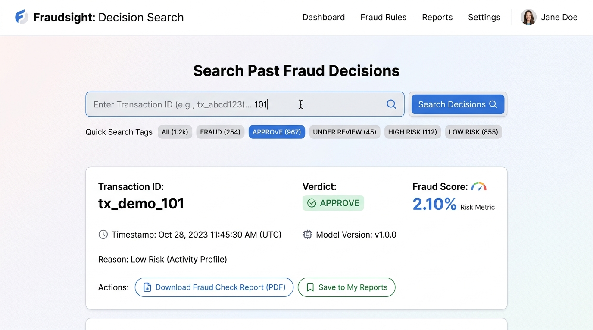
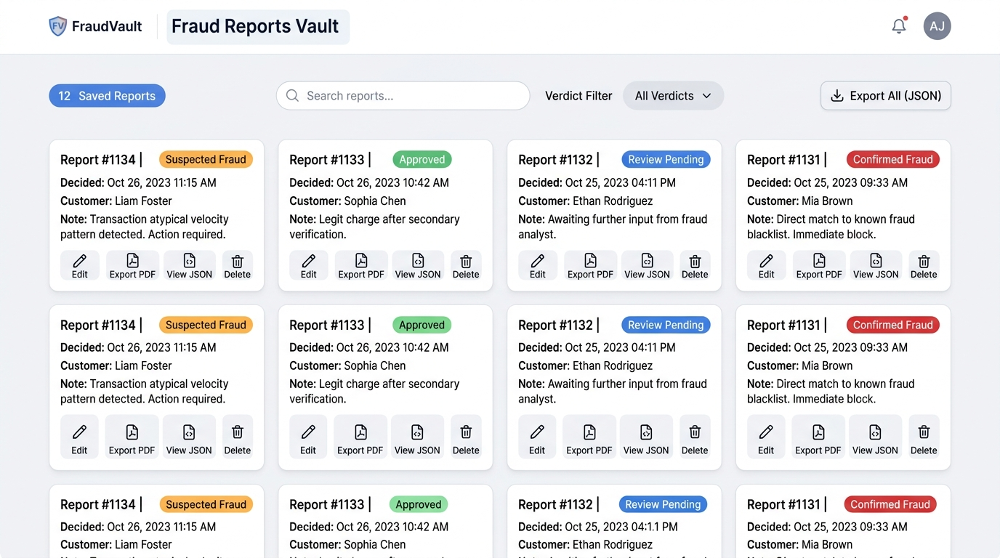
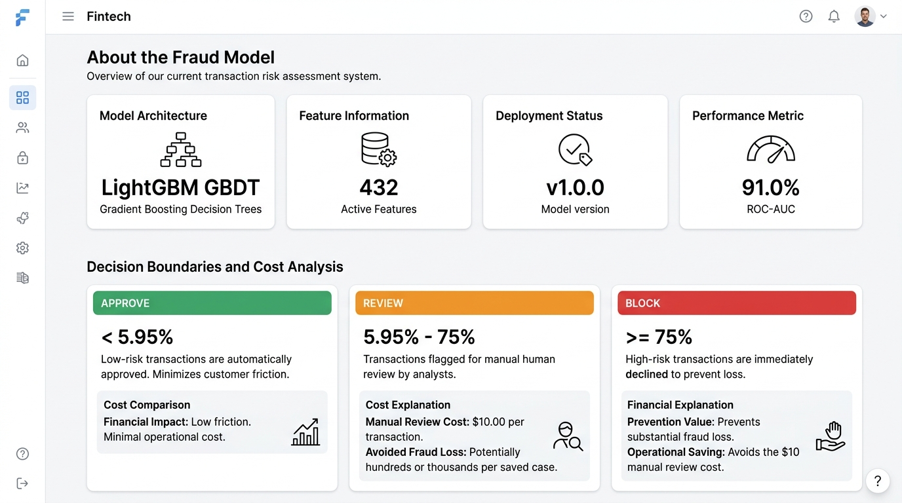

# FraudShield AI — Modern Fraud Scoring Dashboard (Frontend)

A clean, accessible web dashboard built for operations, fraud analysts, and business teams. Designed to evaluate credit card transactions in real time without needing technical or machine learning background.

---

## 📸 Application Screenshots

### 1. Home Dashboard (`/`)
*3-step overview of the platform, quick launch feature cards, and instant risk band legend.*


### 2. Check One Transaction (`/check-one`)
*Real-time single transaction scoring with sample presets, calibrated risk gauge, plain-English reasons, SHAP factor impact chart, and one-click PDF Fraud Check Report.*


### 3. Check Many Transactions (`/check-bulk`)
*Drag-and-drop CSV or JSON upload (up to 1,000 rows) with pre-validation, interactive donut summary, sortable/filterable transaction table, and batch PDF/CSV exports.*


### 4. Find Past Result by ID (`/find-id`)
*Instant database lookup of any previously scored transaction ID to review stored verdicts, risk percentages, engine latency, and audit metadata.*


### 5. Saved Reports Vault (`/saved-reports`)
*Private, on-device storage of your saved checks. Search, filter by verdict, rename notes, download printable PDF Fraud Check Reports, or export all data as JSON.*


### 6. About the Fraud Model (`/model-info`)
*Non-technical guide to model architecture (LightGBM GBDT), active features, live accuracy metrics (ROC-AUC), and the mathematical cost balance between manual reviews and fraud prevention.*


---

## 📖 How to Use (For Non-Technical Users)

### 🟢 1. Checking an Individual Order
1. Click **"Check One"** in the top navigation bar.
2. Enter the **Transaction ID** and **Purchase Amount ($ USD)**.
3. (Optional) Choose the card type, buyer email domain, and device type.
4. *(Tip: Click **"Safe Sample"** or **"Suspicious Sample"** to test immediately with real-world examples!)*
5. Click **"Check Transaction Risk Now"**.
6. The system immediately displays:
   - **Green (Approve):** Safe order, proceed with fulfillment.
   - **Amber (Manual Review):** Moderate risk, check buyer details or contact customer.
   - **Red (Block):** High likelihood of fraud, decline immediately.
7. Click **"Download Fraud Check Report (PDF)"** to save a printable, executive-ready report or **"Save to Vault"** to keep it in your local records.

---

### 📂 2. Checking a Spreadsheet of Transactions (Bulk Check)
1. Click **"Check Many"** in the top navigation bar.
2. Click **"Download Sample CSV"** if you need a template with standard columns.
3. Drag and drop your `.csv` or `.json` file into the upload zone (files can contain up to 1,000 transactions).
4. If your file has missing column headers or negative amounts, the system will highlight the exact issue before sending anything.
5. Click **"Score All Transactions"**.
6. View the summary donut chart showing Approved vs Review vs Blocked totals.
7. Use the search bar or dropdown filter to inspect specific rows, or click **"Inspect"** on any row to view its full attributes and download its individual PDF report.
8. Click **"Download Report (PDF)"** for a batch summary or **"Export CSV"** for an Excel-ready spreadsheet.

---

### 🔍 3. Looking Up a Past Transaction
1. Click **"Find by ID"** in the top navigation bar.
2. Type or paste your Transaction ID (e.g. `tx_demo_101`).
3. Click **"Search Audit Log"**.
4. The system will retrieve the recorded verdict, score, model version, and exact scoring timestamp from the backend database.

---

### 🗄️ 4. Managing Saved Reports
1. Click **"Saved Reports"** in the top navigation bar.
2. View all single checks and bulk batches you saved to your device.
3. Edit titles and custom analyst notes directly in the list.
4. Click **"Export PDF"** to print or archive formal Fraud Check Reports.
5. All data is saved privately in your web browser (`localStorage`) and persists across page reloads.

---

### ⚙️ 5. Connecting to the Backend / Changing Settings
- Click the **"Settings"** (gear icon) in the top-right corner of the navigation bar.
- By default, it connects to `http://localhost:8000` with the demo API key.
- If your server is hosted remotely, enter the new **API Base URL** and **API Key**, then click **"Save Settings"**.
- A green **"Service Online"** indicator in the navbar confirms successful connection.

---

## 🛠️ Technology Stack

- **Framework:** React 19 + Vite 6
- **Styling:** Tailwind CSS (Clean Light Theme: pure whites, soft slate backgrounds, and clear semantic indicators)
- **Visualizations:** Recharts (SHAP factor contribution bar charts & bulk decision donut charts)
- **Icons:** Lucide React
- **Document Generation:** jsPDF (Client-side vector PDF Fraud Check Reports)
- **HTTP Client:** Axios (With dynamic settings, custom error parsing, and timeout controls)

---

## 🚀 Running Locally

### 1. Install Dependencies
```bash
cd frontend
npm install
```

### 2. Configure Environment Variables (Optional)
Create a `.env` or `.env.local` file in `frontend/` if you want to override defaults:
```env
VITE_API_URL=http://localhost:8000
VITE_API_KEY=demo-api-key-12345
```
*(Note: Users can also modify the API Server URL and Secret Key directly in the UI via the **Settings** button in the top navigation bar without touching code!)*

### 3. Start Development Server
```bash
npm run dev
```
Open **`http://localhost:3000`** in your browser.

### 4. Build for Production
```bash
npm run build
```
Generates production assets in `frontend/dist/`.

---

## 📋 Sample Bulk Upload Template
An example file is provided at [`frontend/public/sample_bulk.csv`](./public/sample_bulk.csv). Required headers are:
- `transaction_id`: Unique identifier
- `TransactionAmt`: Purchase amount in USD (must be > $0.00)
- *(Optional attributes)*: `ProductCD`, `card1`, `card2`, `card4`, `card6`, `addr1`, `addr2`, `P_emaildomain`, `R_emaildomain`, `DeviceType`, `DeviceInfo`.
